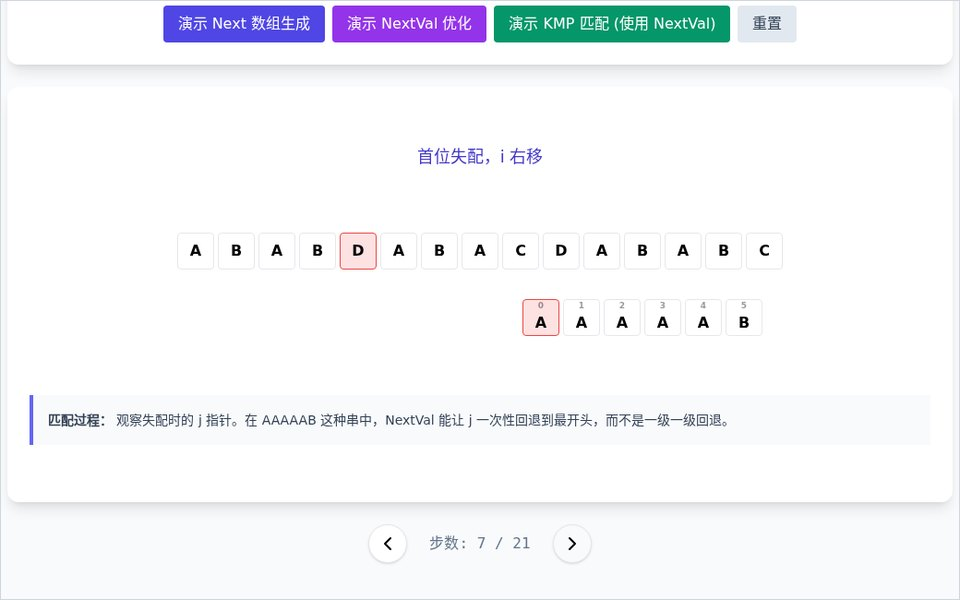
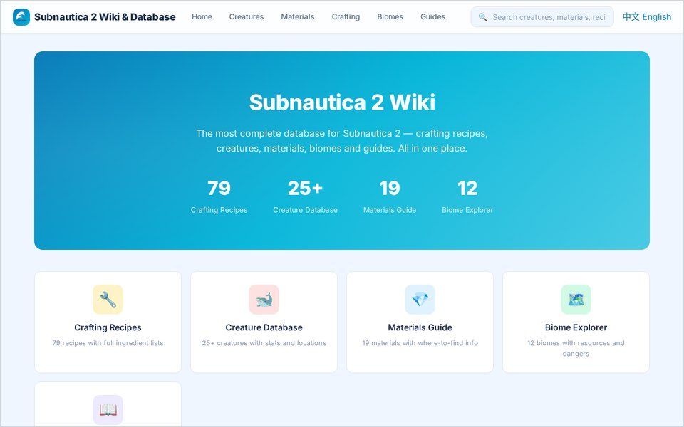
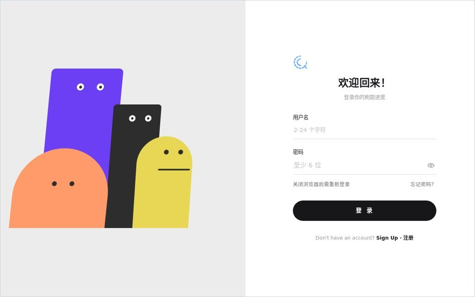

我是周易，在苏州写代码。我喜欢做会动的 AI 和能把东西讲明白的工具：陪你写代码的桌面宠物、一步一步演给你看的算法可视化、游戏资料站，还有一个五子棋 AI。

I'm Zhengyi Zhou, building from Suzhou. I make AI that moves and tools that explain things: a desktop pet for your coding sessions, an algorithm you can watch step by step, a game wiki, and a Gomoku AI.

<samp><a href="https://ciqingz.dpdns.org/">ciqingz.dpdns.org</a> &nbsp;·&nbsp; <a href="https://ciqingz.dpdns.org/quiz">quiz</a> &nbsp;·&nbsp; <a href="https://github.com/Zhengyici?tab=repositories">repositories</a></samp>

## Selected work

<table>
<tr>
<td width="50%" valign="top">

  
<samp>01</samp>&nbsp;&nbsp;<b><a href="https://github.com/Zhengyici/nailong-pet-skill">nailong-pet-skill</a></b>
 
把奶龙放进 Codex 的宠物选择器，一条命令安装，自带动画图集，不用重新生图；也能当模板换成你自己的宠物。
  
A Codex pet skill. One command installs a ready-made animated spritesheet into your local Pets picker. Fork it as a template for your own pet.
  
<samp><a href="https://github.com/Zhengyici/nailong-pet-skill">repo</a> · <a href="https://github.com/Zhengyici/nailong-pet-skill#skillssh-安装">install</a> · Python</samp>
</td>
<td width="50%" valign="top">

  
<samp>02</samp>&nbsp;&nbsp;<b><a href="https://github.com/Zhengyici/Mineradio">Mineradio</a></b>
 
Windows 桌面沉浸式音乐播放器：电影镜头、粒子视觉、歌词舞台和 3D 歌单架。
  
An immersive desktop music player built around cinematic camera shots, particle visuals, a lyric stage and a 3D playlist shelf. Main design by <a href="https://github.com/XxHuberrr">@XxHuberrr</a>.
  
<samp><a href="https://github.com/Zhengyici/Mineradio">repo</a> · <a href="https://github.com/XxHuberrr/Mineradio/releases">download</a> · Electron · Three.js</samp>
</td>
</tr>
<tr>
<td width="50%" valign="top">

  
<samp>03</samp>&nbsp;&nbsp;<b><a href="https://zhengyici.github.io/kmp-visualizer/">KMP Visualizer</a></b>
 
KMP 算法与 NextVal 数组的动态可视化：next[] 怎么生成，模式串怎么跳，i 为什么从不回头。
  
Watch KMP string matching one step at a time: how the next[] and NextVal tables are built, and how the pattern jumps.
  
<samp><a href="https://zhengyici.github.io/kmp-visualizer/">live demo</a> · <a href="https://github.com/Zhengyici/kmp-visualizer">repo</a> · JS · Tailwind</samp>
</td>
<td width="50%" valign="top">

  
<samp>04</samp>&nbsp;&nbsp;<b><a href="https://zhengyici.github.io/subnautica2wiki/">Subnautica 2 Wiki</a></b>
 
Subnautica 2 资料库：79 个配方、25+ 种生物、19 种材料、12 个生物群系和新手指南，全站可搜。
  
A searchable fan database: recipes, creatures, materials, biomes and a beginner guide. Built with Hugo on GitHub Pages. Not affiliated with Unknown Worlds.
  
<samp><a href="https://zhengyici.github.io/subnautica2wiki/">site</a> · <a href="https://github.com/Zhengyici/subnautica2wiki">repo</a> · Hugo</samp>
</td>
</tr>
<tr>
<td width="50%" valign="top">

  
<samp>05</samp>&nbsp;&nbsp;<b><a href="https://ciqingz.dpdns.org/">CIQING</a> + <a href="https://ciqingz.dpdns.org/quiz">Quiz</a></b>
 
我的个人站，和一个刷题助手。登录页上住着四个方块小人，眼睛跟着你的光标转，输密码时它们也会有反应。
  
My corner of the web, plus a quiz app whose login page is home to four block characters that follow your cursor and react while you type your password.
  
<samp><a href="https://ciqingz.dpdns.org/">site</a> · <a href="https://ciqingz.dpdns.org/quiz">quiz</a></samp>
</td>
<td width="50%" valign="top">
<samp>06</samp>&nbsp;&nbsp;<b><a href="https://ciqingz.dpdns.org/">Gomoku AI</a></b>
 
五子棋对弈 AI：搜索算法和神经网络结合的对弈引擎。
  
A Gomoku engine that combines tree search with a neural network.
  
<samp>AlphaZero-style · MCTS · C++</samp>
</td>
</tr>
</table>

## Now building

<table>
<tr><td><samp>A</samp></td><td><b>Local LLM Agent Workbench</b> · 本地大模型 Agent 工作台</td><td><samp>Ollama · LangChain</samp></td><td><samp>in progress</samp></td></tr>
<tr><td><samp>B</samp></td><td><b>AI Video Editor</b> · 会自己剪片的 AI</td><td><samp>—</samp></td><td><samp>in progress</samp></td></tr>
<tr><td><samp>C</samp></td><td><b>Raspberry Pi Desk Robot</b> · 树莓派桌面机器人</td><td><samp>Raspberry Pi</samp></td><td><samp>in progress</samp></td></tr>
</table>

还没上线，做出来会放进上面的列表。Not shipped yet; they move up into Selected work when they're real.

## Tools

<samp>Python · C++ · HTML/CSS/JS · ComfyUI · Stable Diffusion · Ollama · LangChain · Codex · Claude Code · DaVinci Resolve · After Effects · Figma · Raspberry Pi</samp>

 

